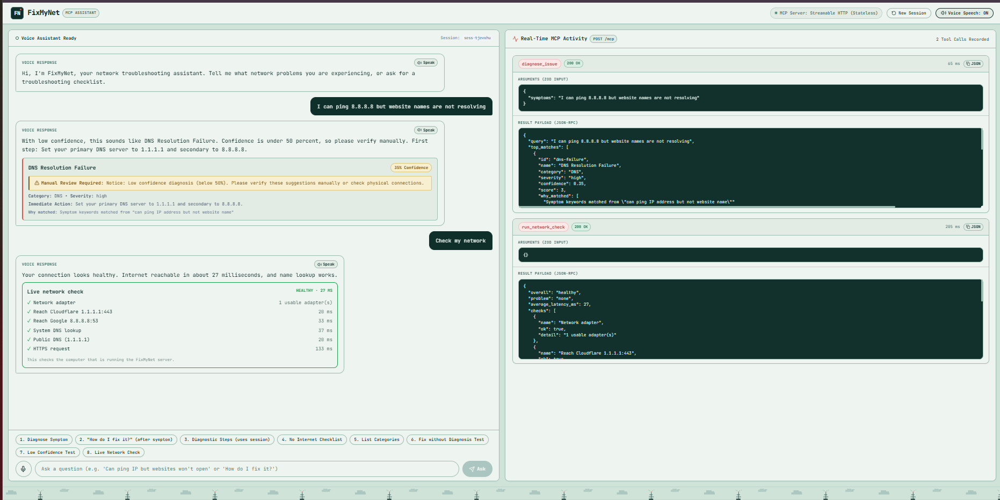

# FixMyNet: Network Troubleshooting Assistant

Submission for the Alexa+ track: a self-hosted MCP server (Streamable HTTP) plus a simulated Alexa+ web app.



**FixMyNet** is an intelligent network troubleshooting assistant built for conversational voice interfaces. It exposes a self-hosted Model Context Protocol (MCP) server adhering to the official **Streamable HTTP transport** specification (negotiating protocol version `2025-11-25` in stateless mode), paired with an interactive web application that provides voice input, spoken answers, session-aware intent routing, and real-time MCP activity inspection.

---

## What It Does

FixMyNet helps users and voice assistants diagnose and resolve home and enterprise network failures in plain English:
* **Fault-First Intent Routing & Session Memory**: Checks for network fault descriptions first, stores the diagnosed fault ID in the session, and only retrieves fix or diagnostic steps when referring to a diagnosed problem. If a user asks for a fix without prior diagnosis, it prompts them to describe the problem first.
* **Deterministic Rule Scoring**: Analyzes free-text symptoms against 20 original network fault profiles (DNS failure, duplex mismatch, VLAN errors, DHCP exhaustion, cable faults, etc.) without relying on cloud LLM uptime.
* **Human-in-the-Loop Safeguards**: Automatically flags low-confidence diagnoses (< 50%) with a manual review notice before suggesting disruptive changes.
* **Voice-Ready Answers**: Every tool outputs concise, speakable text designed for text-to-speech engines (speechSynthesis).
* **Beginner Checklists**: Provides structured, step-by-step troubleshooting workflows for "no internet", "slow network", and "intermittent drops".
* **Interactive Web Interface**: Single-screen dashboard with microphone voice input (Web Speech API), spoken replies, session reset, and a live MCP Activity side panel showing JSON-RPC tool calls, arguments, and latency in real time.
* **Live Network Check**: A sixth tool, `run_network_check`, runs real connection tests on the computer hosting the server: network adapters, TCP connections to 1.1.1.1 and 8.8.8.8, system DNS lookup, a direct query to a public DNS server, and an HTTPS request. It returns a pass/fail checklist with latency. If it finds a problem, it automatically runs the diagnosis engine on it, so you get a fix and "How do I fix it?" works from session memory. Say "check my network" or click the chip.

---

## Architecture Diagram

```text
+-----------------------------------------------------------------------------------+
|                           FIXMYNET WEB APPLICATION                                |
|                             (React + Vite on :5173)                               |
|                                                                                   |
|  +-------------------------------------+   +------------------------------------+ |
|  |     Voice & Chat Assistant Panel    |   |       Live MCP Activity Panel      | |
|  | - Mic button (Web Speech API)       |   | - Real-time tool call inspector    | |
|  | - Spoken audio (speechSynthesis)    |   | - JSON-RPC request & arguments     | |
|  | - Session context memory            |   | - Tool latency (ms) & timestamps   | |
|  | - Voice-ready diagnosis cards       |   | - Full MCP output payload viewer   | |
|  | - One-click demo voice chips        |   | - Copy raw JSON-RPC payload button | |
|  +-------------------------------------+   +------------------------------------+ |
+------------------------------------------+----------------------------------------+
                                           | HTTP POST /api/chat { message, sessionId }
                                           v
+-----------------------------------------------------------------------------------+
|                           EXPRESS SERVER & MCP BRIDGE                             |
|                               (Node.js on :3001)                                  |
|                                                                                   |
|  +------------------------------------------------------------------------------+ |
|  | Session Store: tracks last diagnosed fault ID per session                    | |
|  | Intent Router: fault description first -> session fix/diagnostic -> checklist| |
|  +------------------------------------------------------------------------------+ |
|                                          |
|                                          | StreamableHTTPClientTransport
|                                          v
|  +------------------------------------------------------------------------------+ |
|  | MCP CLIENT LAYER: Calls MCP Tools over official SDK Client Transport         | |
|  +------------------------------------------------------------------------------+ |
|                                          |
|                                          | HTTP POST /mcp (JSON-RPC 2.0)
|                                          v
|  +------------------------------------------------------------------------------+ |
|  | MCP SERVER LAYER (StreamableHTTPServerTransport - Stateless Mode, 2025-11-25)| |
|  |                                                                              | |
|  | Tools:                                                                       | |
|  |  1. diagnose_issue(symptoms)                                                 | |
|  |  2. get_fix_steps(fault_id)                                                  | |
|  |  3. get_diagnostic_steps(fault_id)                                           | |
|  |  4. list_fault_categories()                                                  | |
|  |  5. run_checklist(scenario)                                                  | |
|  |  6. run_network_check()   -> live checks via server/src/netcheck.js          | |
|  +------------------------------------------------------------------------------+ |
|                                          |                                        |
|                                          v                                        |
|  +------------------------------------------------------------------------------+ |
|  | Deterministic Rule Engine & faults.json (20 Original Fault Profiles)         | |
|  +------------------------------------------------------------------------------+ |
|  | Live checks (node:dns, node:net, node:os) on the host computer               | |
+-----------------------------------------------------------------------------------+
```

---

## How It Uses MCP

* **Official SDK**: Built using `@modelcontextprotocol/sdk` (v1.32.1).
* **Protocol Version**: Actively negotiates protocol version **`2025-11-25`** (verified via SDK `SUPPORTED_PROTOCOL_VERSIONS` and runtime client handshake).
* **Streamable HTTP Transport**: Operates over a single `/mcp` HTTP endpoint (replacing older legacy HTTP+SSE architectures) using `StreamableHTTPServerTransport` and `StreamableHTTPClientTransport`.
* **Stateless Mode**: Configured with `sessionIdGenerator: undefined` to ensure robust, isolated, and scalable per-request execution without session state drift.
* **Zod Schemas**: Every tool defines strict Zod input validation schemas and descriptive metadata.
* **Real-time Protocol Inspection**: The web application acts as an MCP client observer, rendering the exact JSON-RPC payload, tool arguments, response schema, and round-trip duration for every voice command.

---

## Known Limitations

* **Deterministic Keyword Matching**: Described symptoms are scored against 20 curated network fault profiles using tokenized keyword and phrase scoring, not a generative model. Unusual phrasing or faults outside those 20 profiles may not match, and the app then shows a manual-review notice and suggests the live check instead of guessing.
* **Live Check Scope**: The `run_network_check` tool tests only the computer that is running the FixMyNet server (adapters, TCP connections to 1.1.1.1 and 8.8.8.8, DNS lookups, and an HTTPS request). It is not a scanner: no packet captures, no port scans, fixed targets only, and nothing a user types is ever used as a target. IP addresses are never returned, only adapter counts.
* **TCP Tests, Not Ping**: Connectivity is tested with TCP connections, not ICMP ping, so it needs no admin rights and works on Windows.
* **Public DNS Check Can Fail on Some Networks**: The direct query to a public DNS server can time out on networks that block direct DNS traffic. It is reported honestly as a failed check, but the overall result only drops to "degraded" if the system DNS lookup also fails.
* **Browser Speech**: Voice input uses the browser Web Speech API, which works best in Chrome or Edge. Chrome's recognition sends audio to a cloud speech service, so voice input needs an internet connection; with the network down, use the text box or the demo chips. In Firefox or Safari, use text input.
* **No Cloud Keys Required**: The MCP server, rule engine, session memory and live checks run locally with no API keys. The optional LLM routing layer is off unless an `OPENAI_API_KEY` is set in `.env`.

---

## Getting Started

### Prerequisites
* **Node.js** v18+ (tested on Node v20 and v24)
* **npm** v9+

### Installation

From the project root directory, install all dependencies:

```bash
# Option 1: One-step install via root script
npm run install:all

# Option 2: Install manually
cd server && npm install
cd ../web && npm install
cd .. && npm install
```

### Running the Application

Start both the MCP server and the web app concurrently:

```bash
npm run dev
```

* **MCP Server & Bridge**: `http://localhost:3001`
  * MCP Streamable HTTP Endpoint: `http://localhost:3001/mcp`
  * Chat Assistant Bridge Endpoint: `http://localhost:3001/api/chat`
* **Web UI**: `http://localhost:5173`

> **Note**: You can also run the server and web application in separate terminals:
> * Terminal 1: `npm run server` (starts server on port 3001)
> * Terminal 2: `npm run web` (starts Vite dev server on port 5173)

### Running Automated MCP Tests

Execute the automated test suite verifying all 6 tools over Streamable HTTP transport and session intent routing:

```bash
npm test
```

---

## Demo Script

Click the **Mic button** (or use the one-click demo chips in the UI) to test the conversation flow:

| Step / Chip | User Query / Voice Utterance | MCP Tool Invoked | Expected Voice & Visual Result |
| :--- | :--- | :--- | :--- |
| **1. Diagnose Symptom** | *"I can ping 8.8.8.8 but website names are not resolving"* | `diagnose_issue` | Identifies **DNS Resolution Failure** (~69% confidence), speaks immediate action, and stores `dns-failure` in session memory. |
| **2. "How do I fix it?"** | First say the symptom (e.g. *"I can ping 8.8.8.8 but website names are not resolving"*), then say *"How do I fix it?"* | `get_fix_steps` | Calls `get_fix_steps` using the fault remembered in the session (`dns-failure`) and returns speakable resolution steps. |
| **3. Diagnostic Steps** | *"What are the diagnostic steps to test it?"* | `get_diagnostic_steps` | Resolves `dns-failure` from session memory and returns speakable testing steps. |
| **4. No Internet Checklist** | *"Run the no internet checklist"* | `run_checklist` | Returns 5 ordered beginner steps starting from physical link verification to DNS resolution. |
| **5. List Categories** | *"What categories of network faults do you know?"* | `list_fault_categories` | Lists all 7 categories (DNS, Addressing & Routing, Physical & Data Link, Switching & VLANs, Performance, Wireless, Security) covering 20 faults. |
| **6** | *"Check my network"* | `run_network_check` (then `diagnose_issue` if a problem is found) | Runs live connection tests on this computer and shows a checklist with latency. If something is wrong, it diagnoses it automatically. |

### Live Check Failure Test
Turn Wi-Fi off, then type "check my network" (or click chip 8). The check reports the connection as down, a diagnosis card appears, and "How do I fix it?" returns fix steps from session memory. Note: Chrome's voice recognition needs internet, so type or use the chip while offline.

### Session Safeguard Tests (Chips 6 & 7):
* **6. Fix without Diagnosis Test**: Click "New Session" (or reload) and ask *"Can you fix my issue?"*. The assistant prompts: *"I haven't diagnosed a network problem yet for this session. Could you describe what issue or symptoms you are experiencing first?"* (No fault card is displayed).
* **7. Low Confidence Test**: Ask *"Something is behaving strangely on my computer"*. When confidence is below 0.5, the assistant adds: *"Notice: Low confidence diagnosis (below 50%). Please verify these suggestions manually or check physical connections."* Only the warning is shown, without misleading fault recommendations.

---

## Configuration (`.env`)

The project runs 100% locally without requiring any third-party API keys. However, an optional LLM intent router is supported if you provide an OpenAI key:

```bash
# Copy example environment configuration
cp .env.example .env
```

Contents of `.env`:
```ini
PORT=3001
# Optional: OpenAI key for LLM intent routing (fallback to rule router if absent)
# OPENAI_API_KEY=your_key_here
```

---

## License

This project is licensed under the [MIT License](LICENSE).
